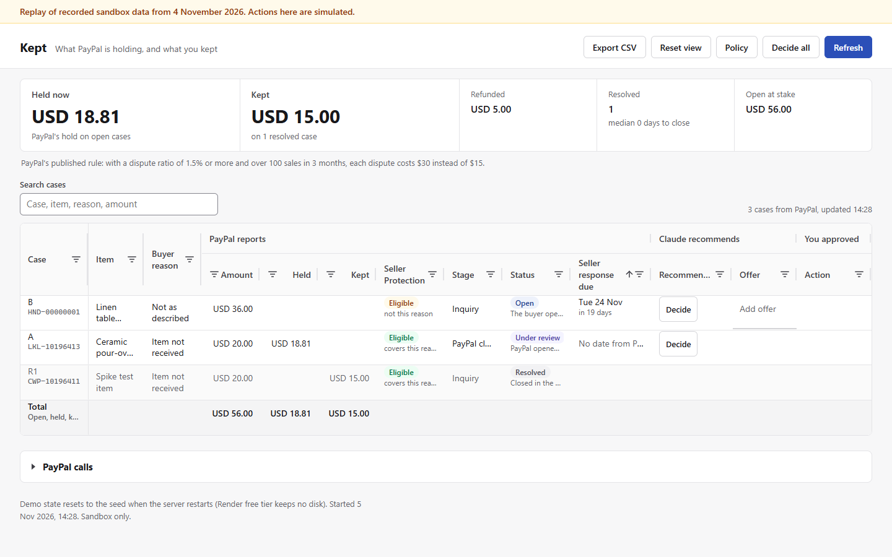
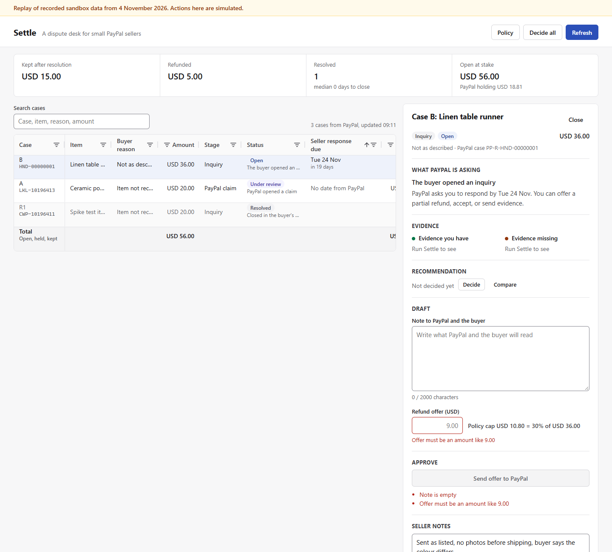
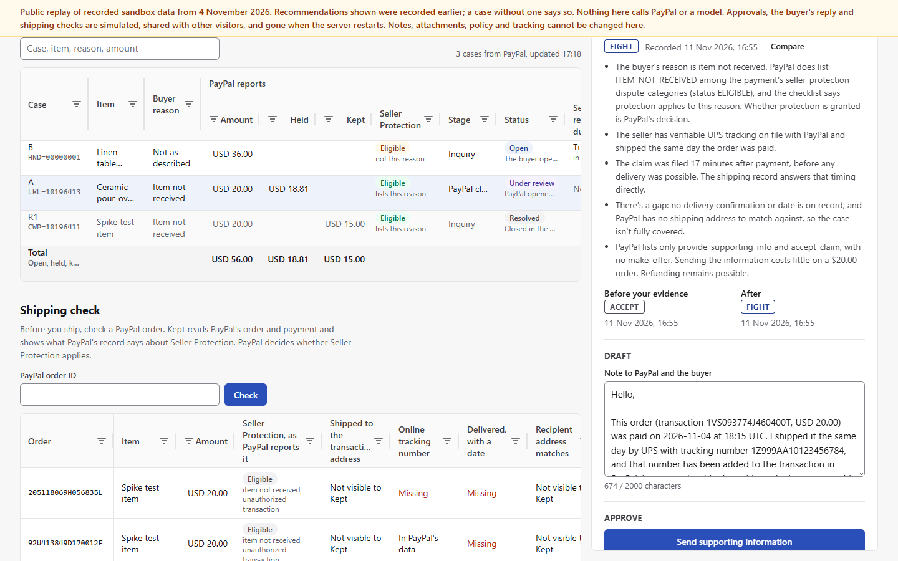

# Kept

**Kept follows a PayPal sale from shipping to dispute to outcome: it checks PayPal's Seller Protection record when you ship, recommends fight, settle or accept when a buyer disputes, sends nothing until you approve, and shows what PayPal reports you kept.**

## Links

- Hosted demo (passcode): https://kept-yplg.onrender.com
- Public replay (no passcode): https://kept-replay.onrender.com
- Video: [VIDEO URL]

Kept shows a small PayPal seller two numbers taken from PayPal's own API: what PayPal is holding from them across their open disputes, and what PayPal says they kept on the resolved ones. **Held now** is the sum of each open dispute's `fund_movements` entries with reason `HOLD_PLACED`. **Kept** is the disputed amount minus PayPal's `dispute_outcome.amount_refunded` on each resolved dispute.

Under those numbers, Claude reads each open dispute, says in plain words what PayPal is asking for, checks whether the payment's Seller Protection lists the buyer's reason, and recommends one move: fight (send evidence or supporting info), settle (a partial refund offer under the seller's cap) or accept (refund in full), then drafts the note. Whether Seller Protection applies is PayPal's decision; Kept only shows what PayPal's record lists. Nothing that touches money is sent until the seller approves it.

The loop is proven live in the PayPal sandbox. In the 2026-11-04 spike, a 5.00 partial refund offer went out on a 20.00 inquiry (`PP-R-CWP-10196411`), the sandbox buyer accepted it, PayPal moved the case to `RESOLVED` with `amount_refunded` 5.00, and the seller kept 15.00 of 20.00. Kept reads that result from PayPal; it does not predict it. Each approved action is sent to the PayPal sandbox and read back, and the held and kept totals are PayPal's reported figures, not estimates.


The case board: Held now and Kept from PayPal's figures, open cases outside the payment's Seller Protection categories, Your record, and what PayPal reports next to what Claude recommends (public replay of recorded sandbox data)


Case B: Claude's recorded call to settle, a refund offer at the seller's policy cap, and the break-even line from PayPal's published dispute fees (public replay of recorded sandbox data)


Case A, a PayPal claim: Claude's reasons, and its call before and after the seller's shipping notes were added, accept then fight (public replay of recorded sandbox data)

## PayPal APIs and AI model used, and where

Everything runs against the PayPal sandbox (`https://api-m.sandbox.paypal.com`).

| What | Endpoint or tool | Called from |
| --- | --- | --- |
| OAuth token | `POST /v1/oauth2/token` | `src/paypal/client.ts` (`getAccessToken`) |
| List disputes | `GET /v1/customer/disputes` | `src/paypal/client.ts` (`listDisputes`), used by `src/http/routes.ts` (the case list, and the seller's record for each decision) and `seed/seed.ts`; also the toolkit tool `list_disputes`, given to the model in `src/ai/tools.ts` |
| Read one dispute | `GET /v1/customer/disputes/{id}` | `src/paypal/client.ts` (`getDispute`), used by `src/http/routes.ts`, `src/actions.ts` and `seed/seed.ts`; also the toolkit tool `get_dispute`, given to the model in `src/ai/tools.ts` |
| Partial refund offer | `POST /v1/customer/disputes/{id}/make-offer` | `src/actions.ts` through `src/paypal/client.ts` (`makeOffer`) |
| Supporting info (claim stage) | `POST /v1/customer/disputes/{id}/provide-supporting-info` (multipart) | `src/actions.ts` through `src/paypal/client.ts` (`provideSupportingInfo`) |
| Evidence | `POST /v1/customer/disputes/{id}/provide-evidence` (multipart) | `src/actions.ts` through `src/paypal/client.ts` (`provideEvidence`) |
| Accept the claim | `POST /v1/customer/disputes/{id}/accept-claim` | toolkit tool `accept_dispute_claim`, called by app code in `src/actions.ts` |
| Create order | `POST /v2/checkout/orders` | `seed/seed.ts` through `src/paypal/client.ts` (`createOrder`) |
| Capture order | `POST /v2/checkout/orders/{id}/capture` | `seed/seed.ts` through `src/paypal/client.ts` (`captureOrder`) |
| Add tracking | `POST /v2/checkout/orders/{id}/track` | `src/shipping.ts` (Shipping check, after the seller approves) and `seed/seed.ts`, through `src/paypal/client.ts` (`addTracking`) |
| Read order | `GET /v2/checkout/orders/{id}` | `src/http/routes.ts` and `src/shipping.ts` through `src/paypal/client.ts` (`getOrder`) |
| Read capture | `GET /v2/payments/captures/{id}` | `src/http/routes.ts` and `src/shipping.ts` through `src/paypal/client.ts` (`getCapture`): for the case list's Seller Protection column (up to 4 at a time, cached with the disputes), the case panel, each decision and each Shipping check |

PayPal Agent Toolkit: `@paypal/agent-toolkit` 1.11.0, `ai-sdk` export. It is constructed in `src/index.ts` with the same sandbox client id and secret. The model gets only `list_disputes` and `get_dispute` (`modelToolset` in `src/ai/tools.ts`). `accept_dispute_claim` is used by app code only, in `src/actions.ts`.

AI model: Claude Opus 5.5, model id `claude-opus-5-5`, set as `MODEL_ID` in `src/ai/provider.ts`, through `@ai-sdk/anthropic` 1.2.12 on the Vercel AI SDK (`ai` 4.3.19). Effort is set to `high` in the same file. The decision loop is `decideCase` in `src/ai/decide.ts`: one `generateText` call per case, `toolChoice: 'auto'`, up to 6 steps per call, with one retry if the model does not submit a decision. The system and user prompts are in `src/ai/prompt.ts`. The model's tools are in `src/ai/tools.ts`.

Other parts: AG Grid Community 36 (`ag-grid-community` 36.3.0) renders two grids in `public/app.js`: the case grid (custom cell renderers, text, number and date column filters, quick filter, row class rules for due-soon and resolved rows, a pinned total row, tooltips, in-place row updates with `applyTransaction`, the Quartz theme) and the Shipping check grid (one row per checked order, cell flashes when PayPal's data changes).

### Live resolution and grid features

On 12 November 2026 Kept sent two capped partial refund offers in the sandbox (7.20 on 24.00 and 8.10 on 27.00); the sandbox buyer accepted both, PayPal resolved both, and the seller kept 16.80 and 18.90.

At the PayPal claim stage, the seller can tick files to send with supporting information; Kept appends "Attached: <names>" to the note and reports whether PayPal's record lists each file, and no file is sent unless ticked. This was checked once in the sandbox on 2026-11-12 with packing-slip.pdf, a sandbox demo document: PayPal's record lists the document.

A visible tab polls waiting cases every 15 seconds; no webhook listener is implemented. When PayPal reports a change, the case row flashes and the summary updates in place. The case panel's **What PayPal reports** timeline is built only from PayPal's offer history, dispute outcome and fund movements (`src/cases.ts`, `public/app.js`). Replay has a separate **Simulate the buyer accepting (replay)** control (`public/app.js`); its API route returns 404 in live mode (`src/http/routes.ts`). Replay actions remain simulated and are identified by the replay banner.

The grid groups columns under **PayPal reports**, **Claude recommends** and **You approved**. Its inline offer editor refuses amounts over the policy cap, with undo and redo for edits. CSV export supports selected cases and guards against spreadsheet formula injection. The seller's grid view, including sort, filters and column layout, persists locally and **Reset view** restores the default (`public/app.js`). These are AG Grid Community features, with no Enterprise module loaded.

## How it works

1. Kept lists the seller's disputes from PayPal and reads each one's capture from the dispute's own capture id (`disputed_transactions[0].seller_transaction_id`), and the order from the capture's `supplementary_data.related_ids.order_id`, so Seller Protection shows even for a dispute with no seed record (`orderAndCapture` and `fetchCaptures` in `src/http/routes.ts`). It totals Held now and Kept from PayPal's fields (`summarize` in `src/cases.ts`) and compares the capture's `seller_protection.status` and `dispute_categories` with the dispute reason (`MERCHANDISE_OR_SERVICE_NOT_RECEIVED` maps to `ITEM_NOT_RECEIVED`, `UNAUTHORISED` to `UNAUTHORIZED_TRANSACTION`; any other reason is outside the categories).
2. For each case the model reads the dispute through the toolkit read tools, gets the order, the capture with its Seller Protection, the seller notes and attachment names in the prompt, sees the seller's own JPEG and PNG photos as images (the 3 newest; text inside a photo is treated as data), is asked to weigh Seller Protection against the reason, and returns a structured decision through `submit_decision`: FIGHT, SETTLE or ACCEPT, an offer amount if SETTLE, reasons, evidence on hand, evidence missing, what it sees in the photos, a drafted note, and `would_change`: the one piece of evidence that would move the call toward the seller, or null. The schema is `DecisionSchema` in `src/decision.ts`; free text is never parsed as a decision.
3. App code validates the decision against the seller's policy and against the actions PayPal lists on the dispute (`validateDecision` in `src/decision.ts`), then shows it in the case panel.
4. The seller edits the draft and approves. App code sends the one PayPal call that matches the action, re-reads the dispute, and shows the state PayPal returns. Every action is logged with what the model recommended, what the seller changed, and PayPal's response.

### The board

The strip above the grid shows, from PayPal's fields (`summarize` in `src/cases.ts`, `renderSummary` in `public/app.js`):

- **Held now.** When there are holds, the figure is a button that lists each PayPal hold on an open case: the case, the amount, when PayPal placed it (`initiated_time`) and its age in days. Kept makes no claim about when PayPal ends a hold.
- **Kept**, on resolved cases.
- **Outside Seller Protection categories**: how many open cases have a buyer reason that is not among the capture's `dispute_categories`, with their disputed total. A case where PayPal reports no status or no category list is counted as not reported, never as outside.
- **Resolved**, with the median days to close, and **Open at stake**.

Under the strip the board shows PayPal's published fee rule as text: with a dispute ratio of 1.5% or more and over 100 sales in 3 months, each dispute costs $30 instead of $15. Kept computes no ratio, because it only sees the seller's disputes, not all their sales.

**Your record** sits below that. For each kind of action Kept sent (partial refund offers, evidence, supporting information, claims accepted) it shows how many cases were sent, how many PayPal resolved and with which outcome, and what was kept of the disputed amount, from PayPal's `amount_refunded`, with n. Below 3 resolved cases it says "Too few to read anything into." It shows counts only, no rates or percentages (`yourRecord` in `src/cases.ts`). When Claude decides a case, the prompt includes up to 3 of the newest resolved cases with the same buyer reason as past facts (`sellerRecordOf` in `src/cases.ts`). The system prompt lets the model cite them, forbids changing the recommendation or offer because of them, and forbids any win rate, percentage, probability or credit to Kept's advice (`src/ai/prompt.ts`). The record describes what Kept sent and what PayPal reported; it does not show that a recommendation caused an outcome.

### What would change this call

The case panel shows **What would change this call** under the reasons when the decision names one. Each decision stores a fingerprint of the seller's notes and attachment names (`evidenceOf` in `src/store.ts`). When the seller adds notes or a file after a decision, the case reads "Seller evidence changed since this recommendation", approval is refused until Claude decides again, and after the new decision the panel shows **Before your evidence** and **After** side by side: the recommendation, the offer and the time of each (`src/cases.ts`, `src/actions.ts`, `public/app.js`). The call may or may not change; Kept shows whichever the model returns.

### Shipping check

A second grid, under the cases, for orders that have not been disputed (`src/shipping.ts`, `public/app.js`). Orders v2 has no list endpoint, so the seller types an order id. Kept reads PayPal's order and its first capture and shows, as PayPal reports them, the capture's Seller Protection status and categories, the same four item-not-received checklist items the case panel uses, and the order's tracker. When there is no tracker, **Add tracking** takes a carrier (UPS, USPS, FedEx or DHL) and a tracking number; after the seller approves in the confirm dialog, Kept sends `POST /v2/checkout/orders/{id}/track` with `notify_payer: false`, reads the order again, and the row shows what PayPal now reports. PayPal adds tracking only to completed payments. PayPal's tracker record does not include the carrier, so Kept shows the number taken from the tracker id and never shows the typed carrier as if PayPal had reported it. The server refuses a second tracker while PayPal's order already shows one, while a send is in flight, or while an earlier outcome is unknown.

### Safety design

- The model holds only read tools (`list_disputes`, `get_dispute`) plus `submit_decision`, which records a decision and sends nothing. It has no tool that moves money or writes to PayPal.
- Money actions (`make-offer`, `accept-claim`, `provide-supporting-info`, `provide-evidence`) are sent only from app code in `src/actions.ts`, and only after the seller approves. Add tracking is sent only from `src/shipping.ts`, after the seller approves.
- The refund cap refuses, it never clamps. The seller sets a maximum offer as a percentage of the disputed amount, an absolute maximum, and a deadline buffer (`src/policy.ts`, default 30%, 50.00 and 48 hours). An offer above either cap or above the disputed amount is blocked and the UI names the limit it breaks.
- Every PayPal call Kept makes from app code is recorded in the call log; the model's read calls go through the PayPal Agent Toolkit and are listed in each decision's tool calls.
- The server re-checks every approve (`performAction` in `src/actions.ts`): it re-reads the dispute from PayPal, refuses an action PayPal does not list for the case, refuses a stale recommendation (including one made before the seller's evidence changed), refuses a second action on a case, re-runs the policy check on the submitted amount and note, and blocks a retry while an earlier outcome is unknown.

### Case states

The plain-words state comes from `explainState` in `src/paypal/dispute.ts`.

| PayPal state | Kept shows | Seller can act |
| --- | --- | --- |
| `INQUIRY`, no seller actions listed yet | PayPal is still opening this case | No (refresh in a few minutes) |
| `INQUIRY` with `make_offer` listed | The buyer opened an inquiry | Offer, accept, or evidence, as PayPal lists |
| Waiting for buyer, offer on file | Your offer is with the buyer | No |
| `CHARGEBACK` with `provide_supporting_info` listed | PayPal opened a claim (with PayPal's hold amount if any) | Supporting info or accept |
| `CHARGEBACK`, seller info submitted | PayPal is reviewing your supporting information | No |
| `RESOLVED` | Closed in your favour, in the buyer's favour, accepted, or withdrawn | No |

## Run it locally

Needs Node 24.

```
npm ci
npm run dev
```

Then open `http://localhost:3000` and enter your passcode. `npm run dev` runs `src/index.ts` with `tsx watch`. For a production build: `npm run build`, then `npm start`.

| Variable | Purpose | Where to get it |
| --- | --- | --- |
| `PAYPAL_CLIENT_ID` | Sandbox REST app client id | developer.paypal.com, Apps and Credentials, Sandbox, your business app |
| `PAYPAL_CLIENT_SECRET` | Sandbox REST app secret | Same app |
| `ANTHROPIC_API_KEY` | Key for the model that writes the recommendation | console.anthropic.com |
| `KEPT_PASSCODE` | Passcode the page asks for before any `/api` call. After 5 wrong passcodes from one IP in 10 minutes, `/api` answers 429 until the window passes | Any string locally; a long random passcode (24 or more characters) for the hosted demo |
| `PORT` (optional) | HTTP port, default 3000 | |
| `KEPT_DATA_DIR` (optional) | Where runtime state is written, default `./data` | |
| `KEPT_SEED_PATH` (optional) | Seed case file, default `seed/cases.json` | |
| `KEPT_FAKE_PAYPAL` (optional) | `1` starts replay mode, below | |
| `KEPT_PUBLIC_REPLAY` (optional) | `1`, together with `KEPT_FAKE_PAYPAL=1`, starts the public replay demo, below | |

Outside replay mode, if the PayPal pair or the model key is missing, the server stops at startup with `Missing environment variable <NAME>`.

### Replay mode (no credentials)

```
KEPT_FAKE_PAYPAL=1 KEPT_PASSCODE=anything npm run dev
```

Replay mode serves recorded sandbox data, with some cases derived from it (marked `_replay`), from `seed/replay/` (recorded 2026-11-04, personal data redacted) instead of calling PayPal. The Shipping check's sample order `ORDERP1000000001` is invented for replay, modelled on the recorded fixtures, and marked so. The page shows a banner saying it is a replay of recorded sandbox data and that actions are simulated. `KEPT_PASSCODE` is still required. Without `ANTHROPIC_API_KEY`, a case cannot get a new recommendation and says so; with it set, the real model runs against the recorded data.

On Windows PowerShell, set variables first, for example `$env:KEPT_FAKE_PAYPAL='1'; $env:KEPT_PASSCODE='anything'; npm run dev`.

**Public replay demo.** A second Render service, `kept-replay`, runs replay mode with `KEPT_PUBLIC_REPLAY=1` and needs no passcode. It shows recorded sandbox data and the recommendations recorded in `seed/replay/snapshot.json`, including one case decided before and after the seller's notes; a case without one says "No recorded decision for this case". It reads no PayPal or model keys and makes no live PayPal or model calls. Approving (with the recorded note), the buyer's reply and shipping checks are simulated, shared by everyone viewing, and reset when the server restarts; notes, attachments, policy, deciding and adding tracking are off there. `KEPT_PUBLIC_REPLAY=1` without `KEPT_FAKE_PAYPAL=1` stops the server at startup.

## Running it as a judge

No credentials of ours are in this repo or needed. Three paths:

1. Public replay: open the public replay link under Links. No passcode; recorded sandbox data, simulated actions.
2. Hosted demo: open the hosted demo link under Links and enter the passcode given with the submission. The first load can take a while on Render's free tier while the service wakes up.
3. Your own sandbox: create a sandbox business app at developer.paypal.com for `PAYPAL_CLIENT_ID` and `PAYPAL_CLIENT_SECRET`, use your own `ANTHROPIC_API_KEY`, choose a `KEPT_PASSCODE`, run `npm ci` and `npm run dev`, then follow [docs/seeding.md](docs/seeding.md) to create cases with your own sandbox buyer.

To look around locally without any keys, use replay mode above.

## Seeding

Sandbox disputes can only be opened by a sandbox buyer in the Resolution Center, so seeding is part script, part browser. The runbook is [docs/seeding.md](docs/seeding.md). The script is `npm run seed -- order <KEY> | capture <KEY> | track <KEY> | status`, driven by `seed/plan.json`, and it writes `seed/cases.json`.

## Tests

- `npm test`: unit and HTTP tests (Vitest), using recorded PayPal fixtures in `test/fixtures/paypal/`. No network, no keys.
- `npm run typecheck`: TypeScript with no emit.
- `npm run test:e2e`: live sandbox tests in `test/e2e/live.test.ts`. Needs `PAYPAL_CLIENT_ID`, `PAYPAL_CLIENT_SECRET`, `KEPT_PASSCODE` and seeded cases in `seed/cases.json`; the model check skips without `ANTHROPIC_API_KEY`. The accept and evidence tests run only when `KEPT_E2E_ACCEPT_ID` or `KEPT_E2E_EVIDENCE_ID` names the seeded case, because each one spends a case.
- `KEPT_EVAL=1 npm run eval`: the golden-case evaluation in `test/eval/golden.eval.ts`. Needs `ANTHROPIC_API_KEY`; without `KEPT_EVAL` every case skips. Results go to [docs/eval.md](docs/eval.md).

The `test:e2e` script uses a POSIX `KEPT_E2E=1` prefix; on PowerShell set `$env:KEPT_E2E='1'` and run `npx vitest run -c vitest.e2e.config.ts`.

## Evaluation

9 hand-built cases, 3 runs each, against `claude-opus-5-5`. It checks the specific behaviours listed in [docs/eval.md](docs/eval.md); it is not a measure of real-world accuracy. The gate needs 27/27 on recommendation, action, policy and fabrication, and at least 22/27 on mentions. The latest run (2026-11-11) passed the gate with 27/27 on all five checks.

Two of the cases are an evidence pair: the same untracked item-not-received inquiry, once with seller notes that say only "packed and shipped" and once with notes giving UPS tracking and a delivery date. Without the delivery proof the model chose SETTLE in 3 of 3 runs, each time naming a carrier tracking number, ideally with a delivered status, as what would change the call; with it, FIGHT in 3 of 3. Case R is case B plus two resolved not-as-described inquiries in the seller's record; it chose a capped SETTLE in 3 of 3 runs and passed the check that forbids any rate, percentage, probability or credit to Kept's advice.

## Deploy

`render.yaml` is a Render blueprint with two free web services, both Node 24, build `npm ci --include=dev && npm run build`, start `npm start`, health check `/healthz`:

- `kept`, the live sandbox demo. Set `PAYPAL_CLIENT_ID`, `PAYPAL_CLIENT_SECRET`, `ANTHROPIC_API_KEY` and `KEPT_PASSCODE` in the Render dashboard (they are `sync: false`). `KEPT_DATA_DIR` is `/tmp/kept-data`.
- `kept-replay`, the public replay demo. It sets `KEPT_FAKE_PAYPAL=1`, `KEPT_PUBLIC_REPLAY=1` and `KEPT_DATA_DIR=/tmp/kept-replay-data`, and needs no secrets.

`npm run snapshot` writes `seed/snapshot.json` from the decisions, action log and shipping checks in `KEPT_DATA_DIR`'s state file (`--from-url <base>` reads a running instance instead, with `KEPT_PASSCODE` set; `--out <path>` writes elsewhere), and `npm run snapshot:check` checks it for personal data. When that file is present, a restarted live server restores decisions, the action log, the PayPal call log and shipping checks from it. The public replay reads `seed/replay/snapshot.json` instead.

## Architecture

| Path | Role |
| --- | --- |
| `src/index.ts` | Startup: config, store, PayPal client, toolkit, model, HTTP app |
| `src/config.ts` | Environment variables, replay mode and public replay |
| `src/http/app.ts`, `src/http/routes.ts`, `src/http/passcode.ts` | Express app, JSON API, passcode check on `/api` |
| `src/paypal/client.ts` | PayPal REST client: token cache, retries, call log |
| `src/paypal/dispute.ts` | Dispute readers: allowed actions, hold amount, plain-words state |
| `src/paypal/multipart.ts` | Multipart body for supporting info and evidence |
| `src/ai/provider.ts` | Model id, effort, Anthropic provider |
| `src/ai/decide.ts`, `src/ai/prompt.ts`, `src/ai/tools.ts`, `src/ai/queue.ts` | Decision loop, prompts, model tools, decide queue |
| `src/decision.ts`, `src/policy.ts` | Decision schema and validation, offer cap and deadline buffer |
| `src/actions.ts` | The approve path: re-checks, sends the PayPal call, logs it |
| `src/shipping.ts` | Shipping check: order and capture read, add tracking and its guards |
| `src/cases.ts` | Grid rows, case detail, outcome summary, Your record |
| `src/store.ts`, `src/log.ts`, `src/snapshot.ts` | JSON state file, evidence fingerprint, action and call logs, snapshot |
| `src/replay/fakePaypal.ts` | Replay mode PayPal and toolkit stand-ins |
| `public/` | Single-page front end (AG Grid) |
| `seed/` | Seed script, case plan, demo attachments, replay data |
| `scripts/` | Fixture recorder, model smoke test, snapshot tool |
| `test/` | Unit, HTTP, e2e and eval tests |

## Known limits

- Sandbox only. There is no production mode and no multi-seller login beyond the demo passcode.
- Held now covers only the holds PayPal reports inside each open dispute. It is not an account balance, reserve or limitation view, and Kept makes no claim about when PayPal ends a hold.
- One action per case. A sandbox case acted on once is spent.
- State resets on restart. Render's free tier sleeps when idle and keeps no disk, so notes, policy and the log go back to the seed; decisions, the action log, the PayPal call log and shipping checks come back from `seed/snapshot.json` when that file is present. Without it, a restart forgets which cases were already acted on; Kept still re-checks PayPal before any action.
- The recommendation needs a model key. Without `ANTHROPIC_API_KEY` (replay mode) a case shows no new recommendation.
- Files are sent only at the PayPal claim stage with supporting information, not with inquiry-stage evidence or offers. Only PDF, PNG, JPEG and GIF files are supported, validated by content, under 10 MB each and up to 50 MB per send. The public replay cannot send files to PayPal.
- No escalation or appeal flow, no buyer messaging, no webhook listener.
- Shipping check starts from an order id the seller types, reads only the order's first capture, and can read only orders that this app's PayPal credentials can read.
- PayPal's seller response window is 20 days from filing, so late in the judging window the hosted grid is expected to show resolved or expired cases. Every case still shows its recommendation, reasons and log.
- `npm audit --omit=dev` reports 13 advisories (12 high, 1 moderate), all in the dependency tree of the pinned `ai` 4, `zod` 3 and `@paypal/agent-toolkit` versions: zod (GHSA-mrhx-c7xc-m3w5), @ai-sdk/provider-utils (GHSA-866g-f22w-33x8), ai (GHSA-rwvc-j5jr-mgvh), jsondiffpatch (GHSA-33vc-wfww-vjfv, GHSA-j4fx-xxwh-2485), @langchain/core (GHSA-r399-636x-v7f6), langsmith (GHSA-fw9q-39r9-c252, GHSA-rr7j-v2q5-chgv, GHSA-3644-q5cj-c5c7), mathjs (GHSA-29qv-4j9f-fjw5, GHSA-jvff-x2qm-6286) and uuid (GHSA-w5hq-g745-h8pq, moderate); the other flagged packages (@ai-sdk/anthropic, @ai-sdk/react, @ai-sdk/ui-utils, openai) are flagged through these. Clearing them means moving off `ai` 4 and `zod` 3, which this submission does not do.

## License

MIT, see [LICENSE](LICENSE).
